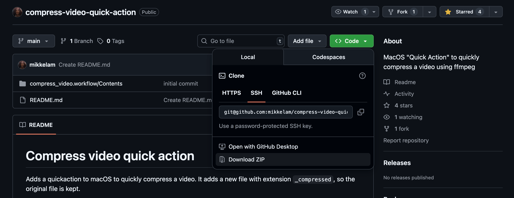
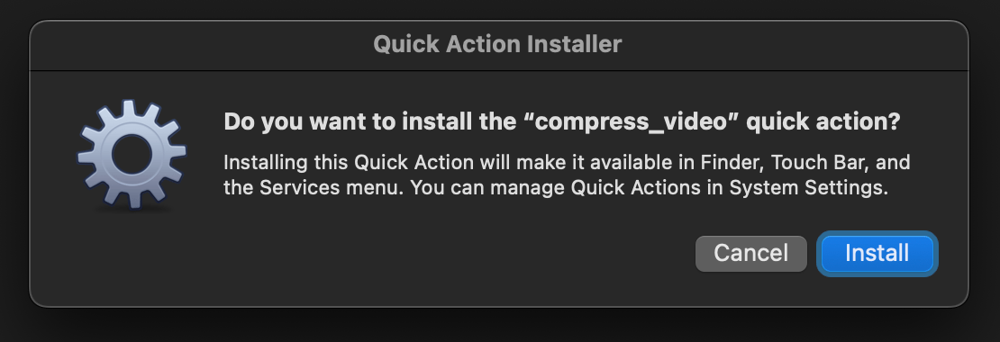

# Compress video quick action

Adds a quickaction to macOS to quickly compress a video. It adds a new file with extension `_compressed`, so the original file is kept.


## Requirements

```
/bin/zsh
/opt/homebrew/bin/ffmpeg
```

You can easily change these paths in the workflow.

## Installation

1. Click on the green `Code` button and choose `Download ZIP` in the menu
   
2. Open the `compress_video.workflow` file and click `Install`
   
